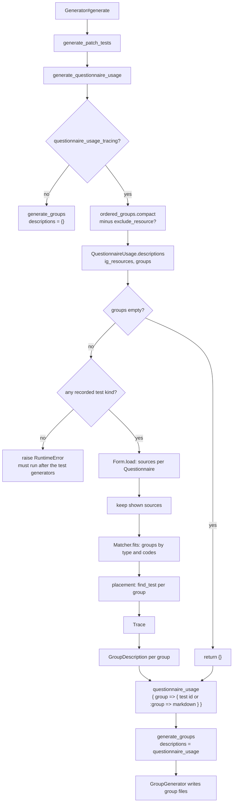
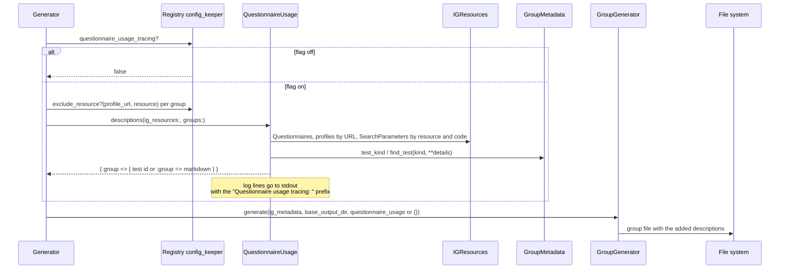

# generate_questionnaire_usage: how questionnaire items are traced into test descriptions

Source files:

- [lib/inferno_suite_generator.rb](../lib/inferno_suite_generator.rb) (Generator#generate_questionnaire_usage, Generator#generate_groups)
- [lib/inferno_suite_generator/core/config/getters.rb](../lib/inferno_suite_generator/core/config/getters.rb) (questionnaire_usage_tracing?)
- [lib/inferno_suite_generator/core/config/generators.rb](../lib/inferno_suite_generator/core/config/generators.rb) (GeneratorConfigKeeper#exclude_resource?)
- [lib/inferno_suite_generator/questionnaire_usage.rb](../lib/inferno_suite_generator/questionnaire_usage.rb) (QuestionnaireUsage.descriptions, the entry point)
- [lib/inferno_suite_generator/questionnaire_usage/](../lib/inferno_suite_generator/questionnaire_usage/) (Form and its sources: LaunchContext, Query, Include, Template; Chain, Codes, CheckedElements, Trace, GroupDescription)
- [lib/inferno_suite_generator/core/group_metadata.rb](../lib/inferno_suite_generator/core/group_metadata.rb) (GroupMetadata#add_test, #test_kind, #find_test)
- [lib/inferno_suite_generator/generators/group_generator.rb](../lib/inferno_suite_generator/generators/group_generator.rb) (GroupGenerator, the only writer of the added text)
- [lib/inferno_suite_generator/templates/group.rb.erb](../lib/inferno_suite_generator/templates/group.rb.erb) (the generated group file)

---

## 1. What

```ruby
def generate_questionnaire_usage
  config = Registry.get(:config_keeper)
  return unless config.questionnaire_usage_tracing?

  groups = ig_metadata.ordered_groups.compact.reject do |group|
    config.exclude_resource?(group.profile_url, group.resource)
  end
  self.questionnaire_usage = QuestionnaireUsage.descriptions(ig_resources:, groups:)
end
```

generate_questionnaire_usage reads the SDC `Questionnaire` resources in the IG and works out, for each generated test, which questionnaire items depend on the request that test makes. The result is Markdown that generate_groups appends to the group and test descriptions as a **Used in questionnaires** section:

- each test that makes the same request a questionnaire makes lists the forms, their sources and the items that use each source, with the element paths each item reads
- the Must Support test lists the elements items read that the group's tests check
- the group description summarizes which tests cover each form, the requests no test makes and the elements no test checks

It is off by default. A kit turns it on in its config:

```json
{
  "configs": {
    "generic": {
      "questionnaire_usage_tracing": true
    }
  }
}
```

| # | Source | Config key | Default |
|---|--------|------------|---------|
| 1 | Turn tracing on (only the JSON boolean true does) | configs.generic.questionnaire_usage_tracing | off |
| 2 | Leave a profile's group out | configs.profiles.PROFILE_URL.skip_generation or .skip | not skipped |
| 3 | Leave a resource type's groups out | configs.resources.RESOURCE_TYPE.skip_generation or .skip | not skipped |

The output:

- Generator#questionnaire_usage holds `{ group_metadata => { "test_id" | :group => markdown } }`. A group gets an entry only when a source fits it or one of its tests lists a source. It stays nil when the flag is off.
- generate_groups passes it, or `{}`, as the third argument of GroupGenerator.generate, which writes it into each group file.
- With the flag off, or with no Questionnaire in the IG, the generated kit is byte-identical to a kit generated without this feature. metadata.yml and demodata.yml never change.

For a Patient group with read and Must Support tests, `name.family` Must Support, and a form whose launch context `patient` pre-fills two items, the read test gets:

```markdown
**Used in questionnaires**

These questionnaires in the IG read Patient resources as this test does: by id, or as the resource a form is opened for. A form can pre-fill an item only if the server returns the elements the item reads. Elements marked (not checked) are neither Must Support nor required by the profile, so this group's tests do not check them.

- **Demo form**
  - **Launch context patient**: the Patient the form is opened for
    - **Family name**: pre-fills the answer; reads name.family
    - **Marital status**: pre-fills the answer; reads maritalStatus (not checked)
```

the Must Support test gets:

```markdown
**Used in questionnaires**

Items in these questionnaires read elements of Patient that this group's tests check. A form can pre-fill an item only if the server returns the elements the item reads.

- **Demo form**
  - **name.family**: Family name
```

and the group description gets:

```markdown
**Used in questionnaires**

These questionnaires in the IG read or create Patient Profile resources. The tests that make the same requests list the form items that depend on them.

- **Demo form**: see the read and Must Support tests

**Elements not checked**

The profile neither marks these elements Must Support nor requires them, so no test checks that the server returns them.

- **Demo form**
  - **maritalStatus**: Marital status
```

## 2. Why

Many IGs publish questionnaires that read from the FHIR server to pre-fill answers (`x-fhir-query` variables, `sdc-questionnaire-launchContext`) and write back to it on extraction (`sdc-questionnaire-templateExtract`). A server can pass the read test and still break such a form, because an item reads an element the profile neither marks Must Support nor requires, so no test checks it. The section shows a tester which tests matter to which forms, and which form reads nothing checks.

Tracing only documents coverage. It adds no tests and changes nothing a test checks.

Why does it run after every test generator? It looks tests up by the kind and details each generator recorded through GroupMetadata#add_test. Before the generators run there is nothing to find, and QuestionnaireUsage.descriptions raises "Questionnaire usage tracing must run after the test generators: no group has a recorded test." for a non-empty group list.

Why before generate_groups? GroupGenerator is the only place that writes the group file, so the text has to be ready when it runs. Tracing itself writes no files and changes no groups.

Why only Markdown lists, bold and plain text? Inferno shows tables without borders and raw HTML as text.

## 3. How (step by step)

### Step 0: Entry point

1. Generator#generate calls generate_questionnaire_usage after generate_patch_tests and before generate_groups.
2. If `questionnaire_usage_tracing?` is false it returns at once: nothing is traced and questionnaire_usage stays nil.

### Step 1: Choose the groups

1. ig_metadata.ordered_groups.compact drops nil entries.
2. Groups for which exclude_resource?(profile_url, resource) is truthy (skip_generation, then skip, each looked up under the profile and then the resource type) are left out, the same way the test generators leave them out.
3. QuestionnaireUsage.descriptions(ig_resources:, groups:) is called once. With no groups it returns `{}`.

### Step 2: Collect each form's sources

Every Questionnaire in the IG is traced. A form's sources are listed in this order, each in document order:

1. Queries: each `variable` extension with language `application/x-fhir-query`, on the root or on any item. A query is a read when an id follows the resource type (`Patient/{{%patient.id}}`), otherwise a search. Its search parameters are the names without modifiers; a compartment search adds the compartment (`patient`); result-shaping parameters such as `_sort`, `_count` and `_include` are not search parameters.
2. Includes, right after their query: each `_include=TYPE:PARAM[:TARGET]`, one source per target type. Without an explicit target, the target comes from the IG SearchParameter, else from the types the form's own FHIRPath picks out of the query's results.
3. Launch contexts: each root `sdc-questionnaire-launchContext`, one source per `type`.
4. Templates: each `sdc-questionnaire-templateExtract` whose `template` reference names a contained resource. A template with a `…/TemplateExtractExtensionPatchRequestUrl` sub-extension is a FHIRPath Patch; any other creates a resource.

### Step 3: Find the item uses

1. An item use is a `text/fhirpath` expression on the root or an item that reads a source's `%name`, directly or through FHIRPath variables.
2. The action comes from the extension, for example initialExpression "pre-fills the answer" and enableWhenExpression "shows or hides the item".
3. The element paths it reads are relative to the resource (`name.family`, `value.value`). On a search Bundle only chains through `entry` … `resource` read elements.

### Step 4: Match sources to groups

1. By resource type first. A launch context, a read query and an include fit every group of their type.
2. A search query or a create template is also matched by the `code` and `category` the profiles fix, so a vital-signs query goes to the profile whose code it asks for.

### Step 5: Pick the test that lists each source

A source is shown when an item uses it, when it is a template, or when it is a query with its own `_include`. For each group the source fits, the first test found in this order lists it:

| Source | Tests tried, in order |
|---|---|
| Launch context, or a read query | the group's `read` test |
| Search query | the group's `search` test with the same `search_names`, in any order. A query with no search parameters has no test. |
| Include | for each group of the query's type: its `include` test with the query's `search_names` and `include_targets` equal to this group's resource, then its `include` test with those `include_targets` |
| Create template | the group's `create` test |
| Patch template | the group's `patch` test, then its `update` test recorded with `option: "update"`. An update test that creates the resource is never used. |

1. Tests are found only through GroupMetadata#find_test(kind, **details). Custom generators that subclass the built-in ones inherit kind recording and can override `test_details` to add details.
2. A source with no such test appears in the group summary under **Not tested by this group**.

### Step 6: Decide which elements are checked

1. A group's profile checks a path when it is a Must Support element or slice, a mandatory element, `id`, or part of a Must Support extension slice.
2. For a source, a path counts as checked when any group the source fits checks it. Item lines mark the other paths `(not checked)`, and the group summary lists them under **Elements not checked**.
3. The Must Support section is narrower: it lists only the elements the group's own profile checks, and only when the group has a must_support test.

### Step 7: Build the Markdown

1. GroupDescription builds each group's entry: a section per test that lists sources, a Must Support section, and the `:group` summary.
2. Item lines are capped at 25 per source and Must Support item labels at 10 per element.

### Step 8: Log what is skipped

Anything the tracer cannot handle (a FHIRPath expression that does not parse, an `_include:iterate`, a template with no contained resource, a source with no matching group) is logged to stdout with the prefix `Questionnaire usage tracing: ` and skipped. Generation goes on.

### Step 9: Write the group files

1. generate_groups calls GroupGenerator.generate(ig_metadata, base_output_dir, questionnaire_usage || {}).
2. The group text is appended to the built-in group description.
3. A test with added text is emitted as

   ```ruby
   test from: :<id> do
     description [description, %(
   <text>
     )].compact.map(&:strip).join("\n\n")
   end
   ```

   so the text follows the test's own description. Tests without added text keep their plain `test from: :<id>` line.
4. GroupGenerator escapes `\`, `(`, `)`, `#{`, `#@` and `#$`, so the file compiles whatever the questionnaire text contains.

### Step 10: Return

generate_questionnaire_usage returns the descriptions hash (nil when the flag is off) and keeps it in Generator#questionnaire_usage. Generator#generate ignores the return value; generate_groups reads the accessor.

## 4. Diagrams

### Flow



### Sequence



## 5. Running the tests

The tests build small in-memory questionnaires and groups and call the public entry points: QuestionnaireUsage.descriptions, GroupMetadata, GroupGenerator.generate and Generator#generate_questionnaire_usage.

```sh
bundle exec rake                       # tests, RuboCop and Reek
bundle exec rake test                  # whole suite only
bundle exec ruby -Ilib -Itest test/questionnaire_usage_query_test.rb   # one file
bundle exec reek .                     # Reek only
```

When running reek by hand, pass `.`: without a path it reads source from stdin when stdin is not a terminal, as in an editor task or an agent shell. The rake task already does.

| Test file | Covers |
|---|---|
| `test/generator_questionnaire_usage_test.rb` | the flag, excluded groups, pipeline order |
| `test/generator_config_keeper_test.rb` | the flag getter, one config per keeper |
| `test/generator_test_kinds_test.rb`, `test/group_metadata_find_test_test.rb` | kind recording and find_test |
| `test/group_generator_descriptions_test.rb` | writing and escaping the text in the group file |
| `test/questionnaire_usage_launch_context_test.rb`, `test/questionnaire_usage_labels_test.rb` | launch contexts, read and Must Support sections, summary, labels, caps |
| `test/questionnaire_usage_fhirpath_test.rb` | variables, filter arguments, extension reads |
| `test/questionnaire_usage_query*_test.rb` | queries, Bundle chains, code matching, search and read picking |
| `test/questionnaire_usage_include*_test.rb` | `_include` sources and include test picking |
| `test/questionnaire_usage_template*_test.rb` | templates and create, patch and update picking |
