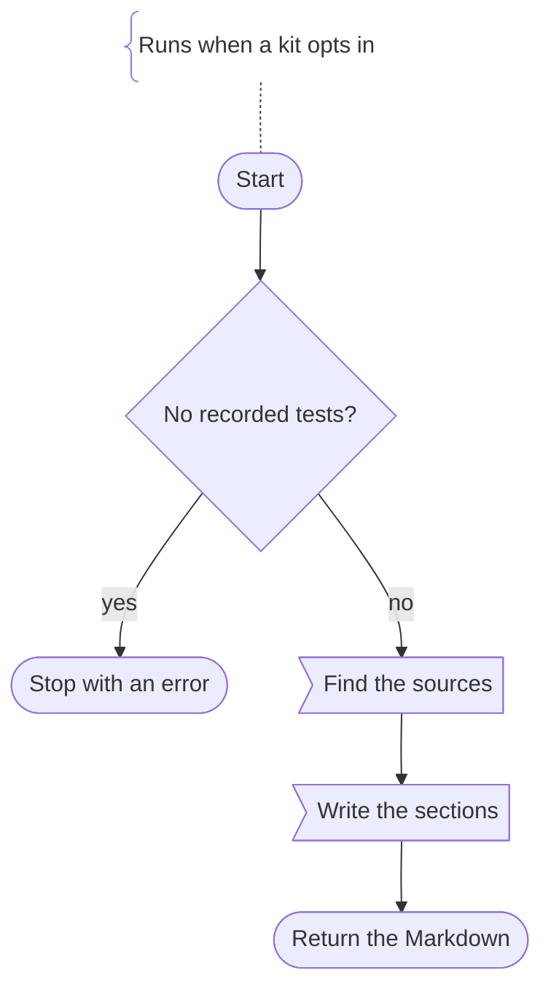
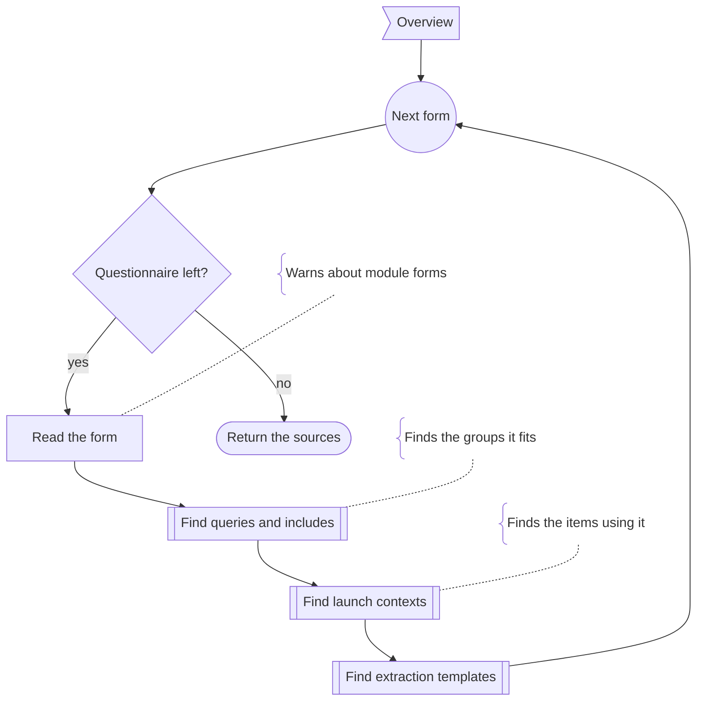
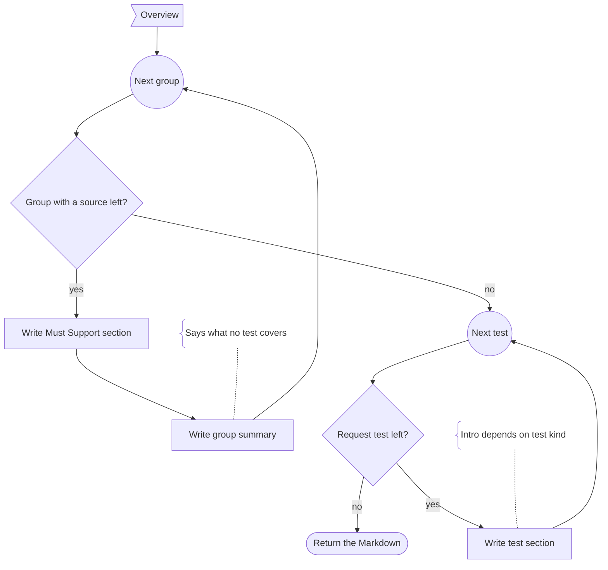
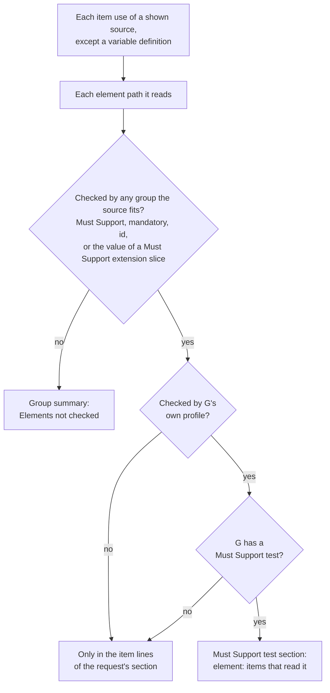

# Questionnaire usage tracing

Traces which SDC questionnaires in the IG use each profile in the suite, and adds a "Used in questionnaires" section to the tests that make the same requests and to the group. Testers see, next to each test, which form items depend on what it checks and which elements those items read.

## Enable it

Tracing is off by default. A kit turns it on in the generator config:

```json
"configs": {
  "generic": {
    "questionnaire_usage_tracing": true
  }
}
```

Without the flag, the generated suite doesn't change. With it, an IG that has no `Questionnaire` resources doesn't change either.

## What it traces

Every `Questionnaire` in the IG package, in three kinds of sources:

- **Queries**: `x-fhir-query` variables, such as `Observation?code=8302-2&patient={{%patient.id}}`, including resources they fetch with `_include`
- **Launch contexts**: `sdc-questionnaire-launchContext` resources, such as `%patient`
- **Template extracts**: contained resources used by `templateExtract`

Each source is matched to the suite's groups by resource type and by the `code` and `category` the profiles fix. Then the generator collects the items that use the source through any FHIRPath expression in their extensions, such as `initialExpression`, `calculatedExpression` or a variable, and the element paths those expressions read.

Sources it can't match to a group are logged as `Questionnaire usage tracing: ...` and left out.

A FHIRPath variable can use only the variables defined before it on the same item, as the FHIR `variable` extension requires. One that uses a later variable is logged and isn't traced.

## What it generates

For each group a questionnaire uses, its sources are split over the group's tests. Each source goes to the test that makes its request:

| Source | Test |
|---|---|
| Launch context, or a query that reads one resource by id | the read test |
| Search query | the search test by the same parameters, in any order |
| `_include` | the include test for this type in the group of the query's own type, preferably the one that searches by the query's parameters |
| Template extract | the create test, or for a FHIRPath Patch the patch test, then the update test |

The generator finds these tests through `GroupMetadata#find_test`. It writes:

- A "Used in questionnaires" section in the description of each of those tests. It's a nested list of questionnaires, the sources in each that the test makes the request of, and the items that use each source. Elements that no group the source fits marks Must Support or requires are marked "(not checked)".
- A section in the Must Support test listing the elements the items read that the group's tests check, each with the items that read it.
- A "Used in questionnaires" section at the end of the group description, with:
  - each questionnaire and the tests that list it
  - **Not tested by this group**: the sources no test makes the request of, in full, with how the group's searches compare to a query's
  - **Elements not checked**: the elements items read that no group the source fits marks Must Support or requires, each with the items that read it

Groups no questionnaire uses keep their descriptions and their tests' descriptions unchanged.

## How it runs

`QuestionnaireUsage.descriptions` runs these steps in order and returns the Markdown to add, as `{ group => { test id or :group => Markdown } }`. `GroupGenerator` writes it to the group files later. In the diagrams here, a dotted line attaches a note to a step.



### Find the sources of each questionnaire

`QuestionnaireUsage.sources` returns a `Source` for each thing a form reads or writes that some group fits, with those groups and the items that use it. A source that fits no group gets none.



Each kind of source is a class in `sources.rb` that finds its sources in a form. To find the items that use a source, `Form#uses` walks the form's items from the node that defines the source. It carries an environment that maps each visible `%name` to where its value came from. That is an `Origin`: the Bundle, its entries or a resource, the resource type a filter picked, the element path, and the element paths read on the way, such as those a `where` filters by. An item that reads a variable reads those too, along with what the other chains of the variable's expression read. A FHIRPath variable that reads a name in the environment is added to it, for its own node and the items under it. An expression on an item is a use when it reads a name in the environment, and `Expression#reads` gives the element paths it reads.

The walk runs once for each source, and once more for each `_include` target type, because each decides by resource type which reads are its own. An `_include` source takes the chains that pick its target type, like `entry.resource.ofType(Location)`, and the query keeps the rest.

### Write the "Used in questionnaires" sections

`Sections#to_h` writes the sections of each group a source fits, then the section of each test that makes a request. [How it picks a test](#how-it-picks-a-test) has the rules.



## How it picks a test

Each source of a group takes two paths. Its request goes to one test: `Sections#test` tries the tests the source names with `Source#lookups`. The elements its items read go to the Must Support test or the group summary: `Sections#shared_elements` says which are checked. Each question is answered in one place, and the test sections and the group summaries both ask there.

### The request

```mermaid
flowchart TD
    entry["Source that fits group G"] --> shown{"Shown?<br/>an item uses it beyond a variable,<br/>or it is a template,<br/>or a query with its own _include"}
    shown -- no --> hidden["Listed by no test"]
    shown -- yes --> source{"kind"}

    source -- LaunchContext --> read["G's read test"]
    source -- Query --> isread{"A read?<br/>like Patient/id"}
    isread -- yes --> read
    isread -- no --> params{"FhirQuery#search_params<br/>empty?"}
    params -- yes --> none
    params -- no --> search["G's search test with the<br/>same names, in any order"]

    source -- Include --> base["groups B of the query's own type,<br/>e.g. PractitionerRole"]
    base --> exact["B's include test with<br/>include_targets = G.resource and<br/>search_names = query params"]
    exact -- not found --> anyinc["B's include test with<br/>include_targets = G.resource"]

    source -- Template --> patch{"patch?"}
    patch -- no --> create["G's create test"]
    patch -- yes --> patchtest["G's patch test"]
    patchtest -- not found --> update["G's update test"]

    read -- found --> section["Used in questionnaires<br/>section in that test"]
    search -- found --> section
    exact -- found --> section
    anyinc -- found --> section
    create -- found --> section
    patchtest -- found --> section
    update -- found --> section

    read -- not found --> none["Group summary:<br/>Not tested by this group"]
    search -- not found --> none
    anyinc -- not found --> none
    create -- not found --> none
    update -- not found --> none
```



An include test belongs to group B, so it lists sources that fit group G. An `_include` fits every group of its target type, so the test lists the source once, and an element counts as checked when any of those groups checks it. All lookups go through `GroupMetadata#find_test`, which finds tests by the kind and details the generators recorded. Those exist only in memory, so `Generator#generate` runs the tracing after the test generators and before `GroupGenerator`, which writes what it returns. Tracing raises when no group has a recorded test.

### The elements



Item lines in every section also show each path, with "(not checked)" after the unchecked ones. `Sections#shared_elements` answers this once for each source, so every section and summary gives the same answer. A Must Support test lists only what its own group's profile checks, since that is all the test looks for.

### The group summary

It lists each questionnaire with the labels of the tests its sources went to, adding the Must Support test when its items read an element the group's own profile checks.

## Generated Markdown

Inferno shows tables without borders and raw HTML as text, so the sections use only nested lists, bold and plain text. `QuestionnaireUsage.descriptions` returns plain Markdown, and `GroupGenerator` escapes it for the group template.

## Layout

- `lib/inferno_suite_generator/questionnaire_usage.rb`: `QuestionnaireUsage.descriptions`, which returns the Markdown to add, and `QuestionnaireUsage.sources`, which finds the sources
- `lib/inferno_suite_generator/questionnaire_usage/`:
  - `form.rb`: one questionnaire: its nodes (the root and the items), their variables and FHIRPath expressions, and `Form#uses`, the walk that finds the items using a `%name`. It also has `ItemUse`: one item using a source, how sections name it and what it does with the source.
  - `expression.rb`: reads one FHIRPath expression: the `%name` names it references and, for the names in an environment, what each chain from a name reads. `Chain` follows the steps after a name from the name's `Origin`.
  - `sources.rb`: a class per kind of source: `LaunchContext`, `Query`, `Include` and `Template`. Each finds its sources in a form, and says whether it's shown, which tests make its request and how a section names it. Add a kind of source here and to `QuestionnaireUsage::KINDS`.
  - `fhir_query.rb`: one x-fhir-query, parsed once: its resource type, whether it's a read, its search parameters, `_include` values and codes
  - `profile_matcher.rb`: finds the groups whose profile a source fits
  - `checked_elements.rb`: the element paths a group's tests check
  - `sections.rb`: decides which test lists each source and which elements count as checked, then writes every "Used in questionnaires" section: the test sections, the Must Support sections and the group summaries
- `lib/inferno_suite_generator/core/group_metadata.rb`: `find_test`, which finds a group's tests by kind and details
- `lib/inferno_suite_generator/generators/group_generator.rb`: appends the added Markdown to the group description and to the tests' descriptions, escaped
- `test/questionnaire_usage_test.rb`: tests through `QuestionnaireUsage.descriptions`: questionnaires and groups in, Markdown out

## Test

```bash
bundle exec rake test
bundle exec ruby -Itest -Ilib test/questionnaire_usage_test.rb
```
