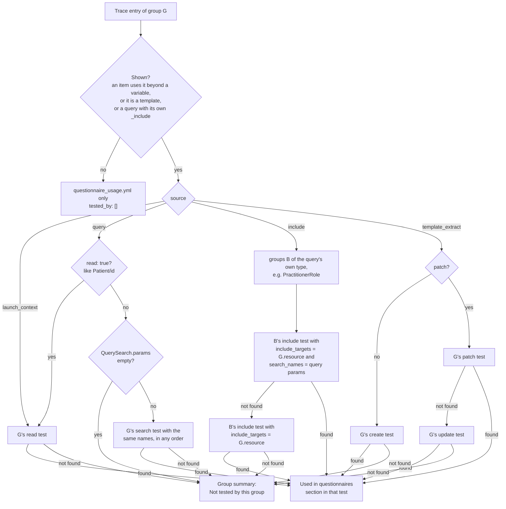
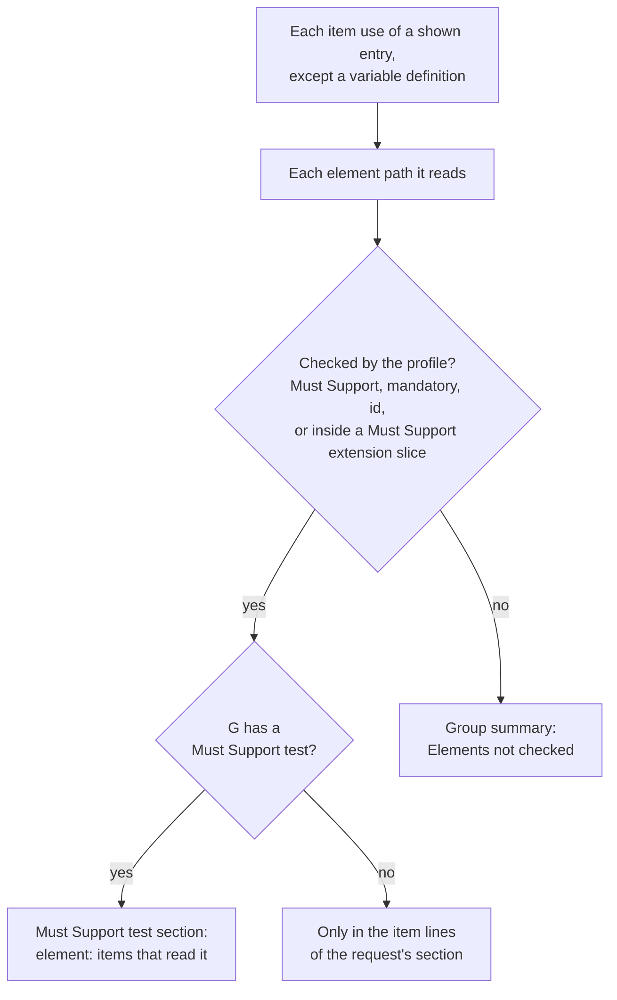

# Questionnaire usage tracing

Traces which SDC questionnaires in the IG use each profile in the suite, and adds a "Used in questionnaires" section to the tests that make the same requests and to the group. Testers see, next to each test, which form items depend on what it checks and which elements those items read.

## Enable it

Tracing is off by default. A kit turns it on in the generator config:

```json
"configs": {
  "generic": {
    "questionnaire_usage_tracing": true
  }
}
```

Without the flag, the generated suite doesn't change. With it, an IG that has no `Questionnaire` resources doesn't change either.

## What it traces

Every `Questionnaire` in the IG package, in three kinds of sources:

- **Queries**: `x-fhir-query` variables, such as `Observation?code=8302-2&patient={{%patient.id}}`, including resources they fetch with `_include`
- **Launch contexts**: `sdc-questionnaire-launchContext` resources, such as `%patient`
- **Template extracts**: contained resources used by `templateExtract`

Each source is matched to the suite's groups by resource type and by the `code` and `category` the profiles fix. Then the generator collects the items that use the source through any FHIRPath expression in their extensions, such as `initialExpression`, `calculatedExpression` or a variable, and the element paths those expressions read.

Sources it can't match to a group are logged as `Questionnaire usage tracing: ...` and left out.

## What it generates

For each group a questionnaire uses, the trace is split over the group's tests. Each source goes to the test that makes its request:

| Source | Test |
|---|---|
| Launch context, or a query that reads one resource by id | the read test |
| Search query | the search test by the same parameters, in any order |
| `_include` | the include test for this type in the group of the query's own type, preferably the one that searches by the query's parameters |
| Template extract | the create test, or for a FHIRPath Patch the patch test, then the update test |

The generator finds these tests through `Generator::TestIndex`. It writes:

- A "Used in questionnaires" section in the description of each of those tests. It's a nested list of questionnaires, the sources in each that the test makes the request of, and the items that use each source. Elements the profile neither marks Must Support nor requires are marked "(not checked)".
- A section in the Must Support test listing the Must Support elements the items read, each with the items that read it.
- A "Used in questionnaires" section at the end of the group description, with:
  - each questionnaire and the tests that list it
  - **Not tested by this group**: the sources no test makes the request of, in full, with how the group's searches compare to a query's
  - **Elements not checked**: the elements items read that the profile neither marks Must Support nor requires, each with the items that read it
- An `entries` list in `<group dir>/questionnaire_usage.yml`, with one entry per source. `tested_by` lists the ids of the tests whose descriptions list the entry:

```yaml
entries:
- source: launch_context
  questionnaire_url: http://example.org/Questionnaire/form
  questionnaire_version: 0.1.0
  questionnaire_title: Example form
  name: patient
  elements_read:
  - birthDate
  used_in:
  - link_id: dob
    text: Date of birth
    extension: initialExpression
    reads:
    - birthDate
  tested_by:
  - au_core_v200_patient_read_test
  - au_core_v200_patient_must_support_test
```

Groups no questionnaire uses get no `questionnaire_usage.yml`, and their descriptions and their tests' descriptions don't change.

## How it picks a test

Each trace entry of a group takes two paths: its request goes to one test (`Router#source_test`), and the elements its items read go to the Must Support test or the group summary (`ElementReads`). `Delivery` makes these decisions once, before anything is rendered, and the test sections, the group summaries and the trace files all read them.

### The request



An include test belongs to group B, so it lists entries traced for group G. An `_include` links to every group of its target type, so the test lists the entry once, and an element counts as checked when any of those groups checks it. All lookups go through `Generator::TestIndex`, which finds tests by the kind and details the generators recorded.

### The elements



Item lines in every section also show each path, with "(not checked)" after the unchecked ones.

### The group summary

It lists each questionnaire with the labels of the tests its entries went to, adding the Must Support test when its items read a checked element. `tested_by` in `questionnaire_usage.yml` holds the same tests' ids.

## Generated Markdown

Inferno shows tables without borders and raw HTML as text, so the sections use only nested lists, bold and plain text. Callers pass plain Markdown to `Generator::GroupDescriptions`, which escapes it for the group template.

## Layout

- `lib/inferno_suite_generator/questionnaire_usage.rb`: `QuestionnaireUsage.generate`, which traces the IG and writes the results
- `lib/inferno_suite_generator/questionnaire_usage/`:
  - `tracer.rb`: finds the sources in each questionnaire and the items that use them
  - `trace_entry.rb`: one source, with a class per kind that says whether it's shown, which test makes its request and how a section names it. Add a kind of source here.
  - `ast.rb`: reads FHIRPath expressions to find the variables and element paths they use
  - `profile_matcher.rb`: matches a source to the groups whose profile it fits
  - `query_search.rb`: splits a FHIR query into its resource type and search parameters
  - `router.rb`: finds the test that makes each source's request
  - `delivery.rb`: decides which tests list each entry
  - `group_trace.rb`: writes one group's Must Support section, trace file and summary
  - `usage_section.rb`: renders the list of sources and their items
  - `checked_elements.rb`: decides which element paths a group's tests check, and how sections name them
  - `element_reads.rb`: renders the elements items read, for the Must Support test and the group summary
  - `test_sections.rb`: adds the section of each test that makes a request
  - `group_summary.rb`: renders the group's section
  - `forms.rb`: groups the shown entries by questionnaire and titles them
- `lib/inferno_suite_generator/core/test_index.rb`: finds a group's tests by kind and details
- `lib/inferno_suite_generator/core/group_descriptions.rb`: collects and escapes the added description text
- `test/questionnaire_usage/`: unit tests for each class, plus `generate_test.rb`, which runs the tracing the way the generator does

## Test

```bash
bundle exec rake test
bundle exec ruby -Itest -Ilib test/questionnaire_usage/generate_test.rb
```
