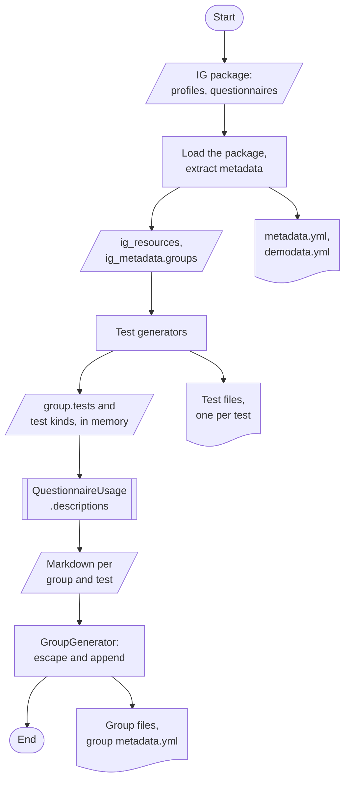
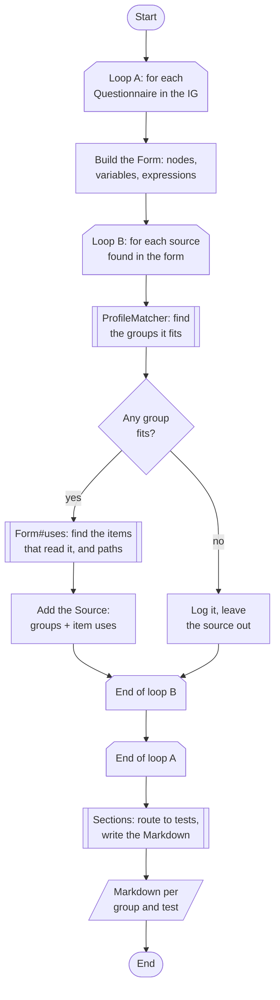
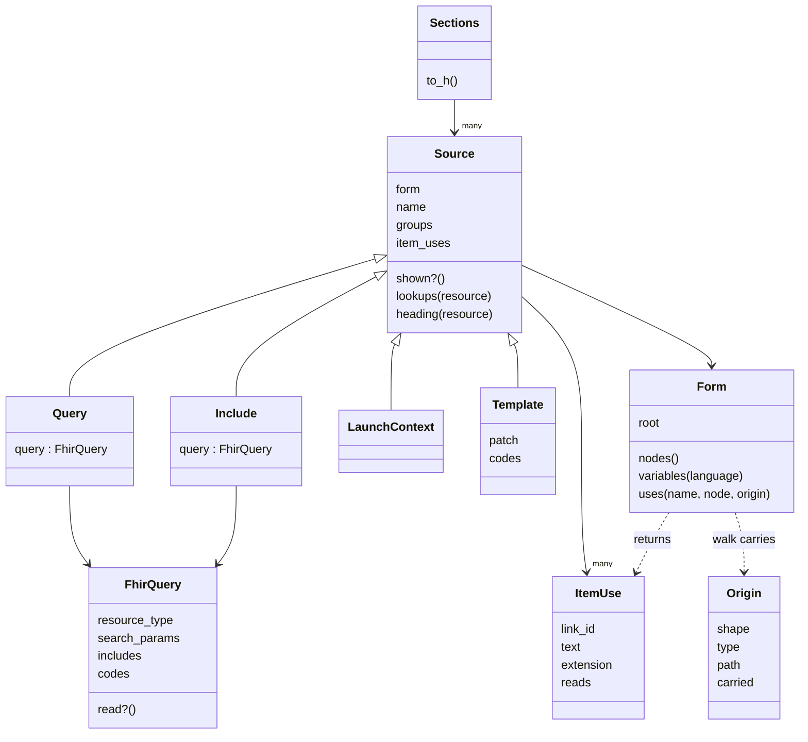
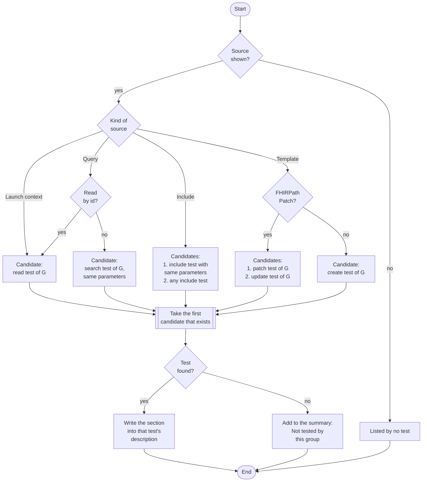
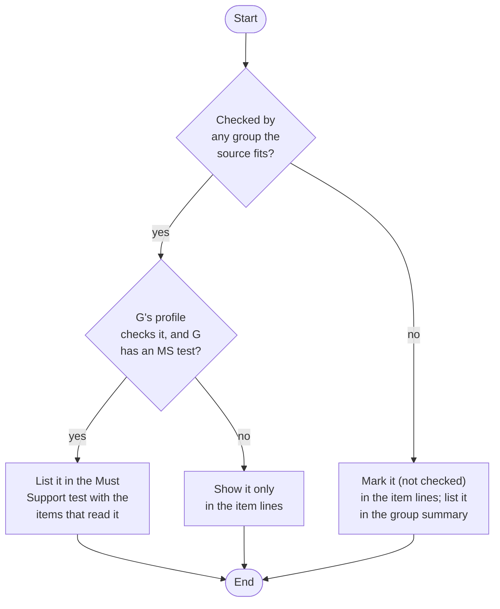

# Questionnaire usage tracing

An opt-in step of the suite generator. It reads every SDC Questionnaire in the IG, works out which server requests each form makes, and writes a "Used in questionnaires" note into the generated test that makes the same request.

A tester running the suite then sees, beside a test, which form items break if that test fails and which elements those items read.

## Enable it

Tracing is off by default. A kit turns it on in the generator config:

```json
"configs": {
  "generic": {
    "questionnaire_usage_tracing": true
  }
}
```

With the flag off, or with no `Questionnaire` in the IG, the generated suite is unchanged.

## The idea in one example

A form defines a query variable and an item that reads it:

```
variable  ObsHeight = Observation?code=8302-2&patient={{%patient.id}}     (x-fhir-query)
item      "Height"  initialExpression = %ObsHeight.entry.resource.value.value
```

The tracer matches the query to the Observation group whose profile fixes code 8302-2, finds that group's search test by `code + patient`, and appends this to the test's description:

```markdown
**Used in questionnaires**

These questionnaires in the IG make this search. A form can pre-fill an item
only if the server returns the elements the item reads. ...

- **Health check**
  - **Query ObsHeight**: searches Observation resources
    - Request: Observation?code=8302-2&patient={{%patient.id}}
    - **Height**: pre-fills the answer; reads value.value
```

## Where it runs

The tracer sits between the test generators and the group generator. It needs the tests to exist, because it looks them up by kind, and it must finish before the group files are written, because that is where its Markdown lands.



The schemes in this document use the symbols of ISO 5807:1985. A parallelogram is data, a rectangle with a wavy bottom is a file that gets written, a rectangle is a process, a rectangle with double sides is a process described elsewhere, a rhombus is a decision, and a rectangle with cut top corners starts or ends a loop.

### What each step produces

The examples below are real output from a two-group run: an Example Patient group and an Example Height group, with one "Health check" form that opens for a patient, defines the query `ObsHeight` and has two pre-filled items.

#### 1. IG package: two objects in memory, two files

The package under `lib/<kit module>/igs/` is loaded and summarised. Nothing here is specific to tracing.

| Result | What it is |
|---|---|
| `ig_resources` | Every resource in the package as a `fhir_models` object, kept by resource type. The tracer asks it three things: `get_resources_by_type("Questionnaire")`, `profile_by_url(url)` for the codes a profile fixes, and `search_param_by_resource_and_code("PractitionerRole", "location")` for an `_include` target. |
| `ig_metadata.groups` | One `GroupMetadata` per profile. It becomes one test group in the suite. |
| `generated/<version>/metadata.yml` | All groups, dumped as YAML |
| `generated/<version>/demodata.yml` | Example data taken from the IG |

The fields of a group that tracing reads:

```ruby
name:               "example_height"
resource:           "Observation"
profile_url:        "http://example.org/StructureDefinition/example-height"
profile_name:       "Example Height"
title:              "Example Height"
searches:           [{ names: ["code", "patient"] }]
must_supports:      { elements: [{ path: "value[x]" }], slices: [], extensions: [] }
mandatory_elements: ["Observation.status"]
tests:              []          # still empty at this point
```

#### 2. Test generators: one file per test, and a record of each test

Each generator writes a test file into the group's folder and registers the test on the group.

```
generated/<version>/
  height/
    height_code_patient_search_test.rb
    height_must_support_test.rb
    height_validation_test.rb
    height_reference_resolution_test.rb
  patient/
    patient_read_test.rb
    patient_must_support_test.rb
    ...
```

Two things are stored on the group. The list goes to `metadata.yml` later. The kinds stay in memory and exist only for `find_test`.

```ruby
group.tests
# => [{ id: "example_height_code_patient_search_test", file_name: "height_code_patient_search_test.rb" },
#     { id: "example_height_must_support_test",        file_name: "height_must_support_test.rb" }]

group.test_kind("example_height_code_patient_search_test")
# => { kind: "search", search_names: ["code", "patient"] }

group.find_test("search", search_names: ["patient", "code"])     # arrays match in any order
# => { id: "example_height_code_patient_search_test", kind: "search", search_names: ["code", "patient"] }
```

| Kind | Details recorded with it |
|---|---|
| `search`, `provenance_revinclude_search` | `search_names` |
| `include` | `search_names`, `include_targets` (every target type of the test) |
| `update` | `option`, such as `"update"` |
| `read`, `create`, `patch`, `must_support`, `validation`, `reference_resolution` | none |

The kind is the generator's `template_type`. A test added without a kind, such as one from a kit's own generator, is not found by `find_test`.

#### 3. `QuestionnaireUsage.descriptions`: a list of sources, then a hash of Markdown

First the intermediate result, `QuestionnaireUsage.sources`: one `Source` per thing a form reads or writes, with the groups it fits and the items that use it. For the example form it returns two.

```
Query
  name:      "ObsHeight"
  form:      Health check
  query:     Observation?code=8302-2&patient={{%patient.id}}
  groups:    [example_height]
  lookups:   [["search", { search_names: ["code", "patient"] }]]
  item_uses: [ItemUse(link_id: "height", text: "Height",
                      extension: "initialExpression", reads: ["value.value", "status"])]

LaunchContext
  name:      "patient"
  form:      Health check
  groups:    [example_patient]
  lookups:   [["read", {}]]
  item_uses: [ItemUse(link_id: "dob", text: "Date of birth",
                      extension: "initialExpression", reads: ["birthDate"])]
```

The height item reads `status` because its expression filters with `where(status = 'final')`. `lookups` is the list of `find_test` calls to try, in order.

Then the final result. The outer key is the `GroupMetadata` object itself. The inner key is `:group` for the group description, or a test id as a string.

```ruby
{
  example_patient => {
    :group                              => "**Used in questionnaires** ...",
    "example_patient_read_test"         => "**Used in questionnaires** ...",
    "example_patient_must_support_test" => "**Used in questionnaires** ..."
  },
  example_height => {
    :group                                    => "**Used in questionnaires** ...",
    "example_height_code_patient_search_test" => "**Used in questionnaires** ...",
    "example_height_must_support_test"        => "**Used in questionnaires** ..."
  }
}
```

The three values for the height group, in full. Each paragraph is one line in the real output; the long lines are wrapped here.

`"example_height_code_patient_search_test"`:

```markdown
**Used in questionnaires**

These questionnaires in the IG make this search. A form can pre-fill an item only if the server
returns the elements the item reads. Elements marked (not checked) are neither Must Support nor
required by the profile, so this group's tests do not check them.

- **Health check**
  - **Query ObsHeight**: searches Observation resources
    - Request: Observation?code=8302-2&patient={{%patient.id}}
    - **Height**: pre-fills the answer; reads value.value (not checked), status
```

`"example_height_must_support_test"`:

```markdown
**Used in questionnaires**

Items in these questionnaires read elements of Observation that this group's tests check. A form
can pre-fill an item only if the server returns the elements the item reads.

- **Health check**
  - **Height**: status
```

`:group`:

```markdown
**Used in questionnaires**

These questionnaires in the IG read or create Example Height resources. The tests that make the
same requests list the form items that depend on them.

- **Health check**: see the search by code + patient and Must Support tests

**Elements not checked**

The profile neither marks these elements Must Support nor requires them, so no test checks that
the server returns them.

- **Health check**
  - **Height**: value.value
```

A group no form uses has no key in the hash.

#### 4. `GroupGenerator`: the same Markdown, escaped for a Ruby string

It receives the hash and looks up `descriptions.dig(group, :group)` and `descriptions.dig(group, test_id)`. The text is placed inside a `%( ... )` literal in the generated file, so a backslash is put before every `\`, `(`, `)` and before `#{`, `#@`, `#$`. Nothing else changes.

```
before:  reads value.value (not checked), status
after:   reads value.value \(not checked\), status
```

#### 5. Generated group files: two per group

```
generated/<version>/
  height_group.rb         the Inferno::TestGroup, with the added text
  height/metadata.yml     the group's metadata, including tests; no kinds, no usage text
  patient_group.rb
  patient/metadata.yml
```

The group summary lands at the end of the group's `description`. A test with added text gets a block that joins the test's own description with it. A test without added text keeps the plain one-line `test from:`.

```ruby
class HeightGroup < Inferno::TestGroup
  title 'Example Height Tests'
  description %(
    # Background
    ...built-in text...

**Used in questionnaires**

These questionnaires in the IG read or create Example Height resources. ...

- **Health check**: see the search by code + patient and Must Support tests
  )

  id :example_v100_height
  run_as_group

  test from: :example_height_code_patient_search_test do
    description [description, %(
**Used in questionnaires**

These questionnaires in the IG make this search. ...

- **Health check**
  - **Query ObsHeight**: searches Observation resources
    - Request: Observation?code=8302-2&patient={{%patient.id}}
    - **Height**: pre-fills the answer; reads value.value \(not checked\), status
    )].compact.map(&:strip).join("\n\n")
  end
  test from: :example_height_must_support_test do
    ...
  end
end
```

### Inside the tracer

Step 3 has two stages of its own: find the sources, then write the sections.



The tests are found through `GroupMetadata#find_test(kind, **details)`. Tracing raises when no group has a recorded test, because that means it ran before the test generators.

## Four kinds of source

A source is one thing a form reads from the server or writes to it.

| Kind | Found in the form as | Matched to groups by | Test that lists it |
|---|---|---|---|
| **Query** | a `variable` extension in `application/x-fhir-query` | resource type, then `code` and `category` values. A read by id fits every group of its type. | search test with the same parameter names, or the read test |
| **Include** | an `_include` of the query's own type, one source per target type | every group of the target type | include test in a group of the query's type, preferring the same search parameters |
| **Launch context** | a root `launchContext` extension, one source per `type` | every group of that type | read test |
| **Template** | a `templateExtract` extension pointing at a contained resource | resource type, then the template's `code` and `category` | create test. For a FHIRPath Patch: patch test, then update test. |

A source that fits no group is logged to the console as `Questionnaire usage tracing: ...` and left out of the output.

## Data model



This one is a UML class diagram, which the flowchart standard does not cover.

## Tracing the items

`Form#uses` walks the item tree from the node that defines a source. It carries an environment, a map from each visible `%name` to an `Origin`: what the value is (a Bundle, its entries or one resource), which resource type a filter picked, and the element path reached so far.

- A FHIRPath `variable` that reads a name in the environment is added to it, for its own node and the items below.
- Any other FHIRPath expression that reads a name in the environment is an **item use**. Its extension says what the item does: pre-fills, calculates, shows or hides, and so on.
- The walk runs once per source and once more per `_include` target type. A chain that picks a target type, like `entry.resource.ofType(Location)`, belongs to the Include; the Query keeps the rest.
- A FHIRPath variable can use only the variables defined before it on the same item, as the FHIR `variable` extension requires. One that uses a later variable is logged and isn't traced.

### How one chain is read

`%ObsHeight.entry.resource.where(status = 'final').value.value`, with `%ObsHeight` bound to a Bundle:

| Step | What the tracer knows after it |
|---|---|
| `%ObsHeight` | Origin: a Bundle, no type, path empty |
| `.entry.resource` | Now at one resource of the Bundle |
| `.where(status = 'final')` | A filter. It reads `status`, which is carried along with the value. |
| `.value.value` | The element path. The chain reads `value.value` and `status`. |

This is a static reading of the syntax tree from the `fhirpath` gem. Nothing is evaluated. After `ofType`, `select`, `resolve`, `children` or `descendants`, the value is no longer treated as an element of the resource and the path stops there.

## Picking a test

Each source goes to at most one test per group.



Terms used in the scheme:

- **G** is the group whose profile the source fits. The scheme runs once for each source and each group it fits.
- **Shown** means an item uses the source, or it is a template, or it is a query with an `_include` of its own.
- **Candidates** are the tests that could make the source's request, in the order they are tried (`Source#lookups`).
- **Take the first candidate that exists** is `GroupMetadata#find_test`, called for each candidate in turn.
- A search test matches when it searches by the same parameter names as the query, in any order. A query with no selecting parameter has no candidate.
- Include tests are looked up in the groups of the query's own resource type, for the target type of G. They are not looked up in G.

## Checked elements

Separately from the request, every element path an item reads is classified. "Checked" means the profile marks it Must Support, requires it (min 1), it is `id`, or it is the value of a Must Support extension slice.



Paths are compared after normalising: slice names are dropped, a typed choice like `valueQuantity` is compared as `value[x]`, and an extension the profile slices is shown by its slice name.

## What gets written

| Place | Content |
|---|---|
| Description of a read, search, include, create, patch or update test | Questionnaires, then the sources whose request this test makes, then one line per item: what it does and which elements it reads. Up to 25 item lines per source. |
| Description of the Must Support test | Items that read elements the group's own profile checks, one line per item with those elements. Items that read the same elements share a line (up to 10 names). A path is left out when the item also reads one of its children, paths with a common start are written once as `prefix: rest, rest` (when the common start is itself one of the paths, they are written in full, e.g. `race extension, race extension.value.code`), and an extension is named by its slice name or the end of its url, with the `value` under it left out (`extension:a.extension[b].value.code` reads as `a extension.b.code`). Items found in several questionnaires are listed once under all of them, the rest under "Only in" that questionnaire. |
| End of the group description | Each questionnaire with the tests that list it. Then "Not tested by this group": sources with no test, with a note comparing the group's searches to the query. Then "Elements not checked", in the same item-by-item form as the Must Support test. |

Only nested lists, bold and plain text are used, because Inferno shows tables without borders and raw HTML as text. Groups no questionnaire uses are untouched.

## File map

| File | Role |
|---|---|
| `lib/inferno_suite_generator/questionnaire_usage.rb` | Entry point: `descriptions`, `sources`, `log` |
| `questionnaire_usage/form.rb` | One questionnaire, the item walk, `ItemUse` |
| `questionnaire_usage/expression.rb` | FHIRPath syntax tree reading: `Expression`, `Chain`, `Origin` |
| `questionnaire_usage/sources.rb` | The four kinds of source and their test lookups. Add a kind here and to `QuestionnaireUsage::KINDS`. |
| `questionnaire_usage/fhir_query.rb` | x-fhir-query parsing |
| `questionnaire_usage/profile_matcher.rb` | Source to groups, by type and codes |
| `questionnaire_usage/checked_elements.rb` | Which element paths a group checks |
| `questionnaire_usage/sections.rb` | Routing to tests and all Markdown |
| `core/group_metadata.rb` | `add_test(kind:, **details)` and `find_test` |
| `generators/group_generator.rb`, `templates/group.rb.erb` | Append and escape the Markdown |
| `test/questionnaire_usage_test.rb` | Tests through `QuestionnaireUsage.descriptions`: questionnaires and groups in, Markdown out |

## Test

```bash
bundle exec rake test
bundle exec ruby -Itest -Ilib test/questionnaire_usage_test.rb
```
