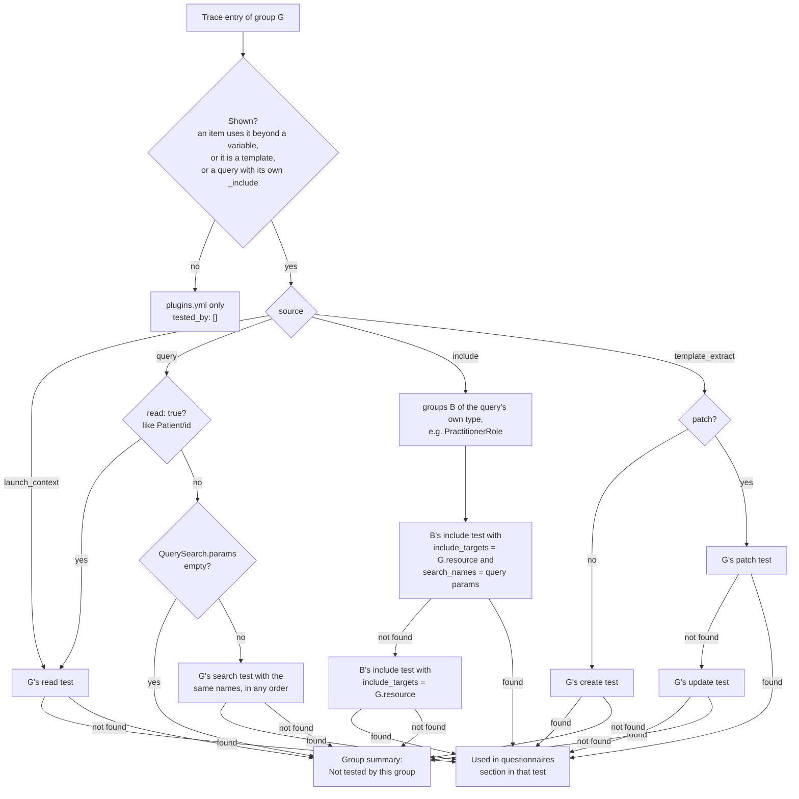
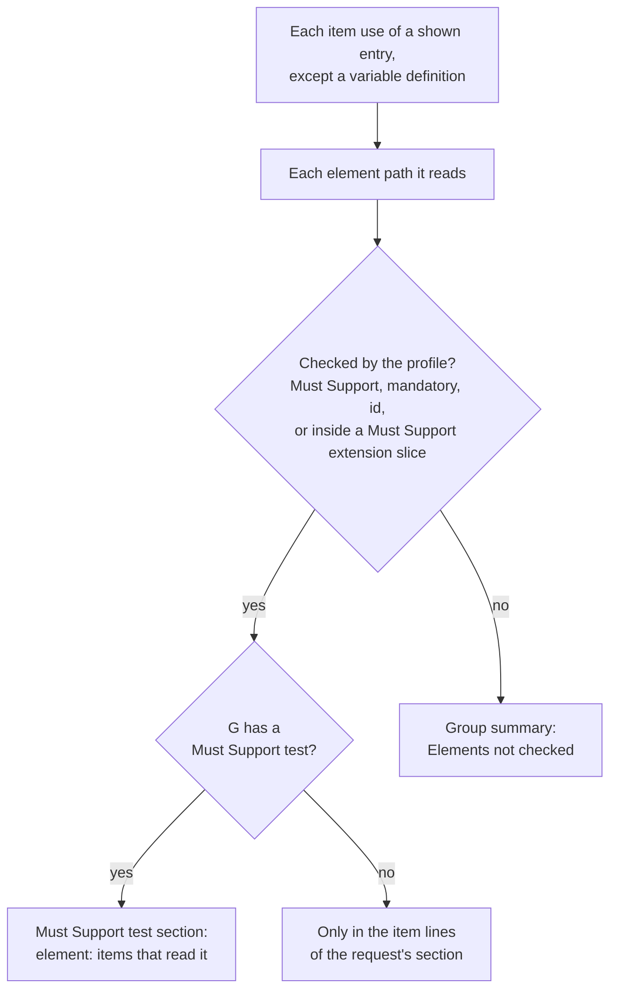

# Questionnaire usage tracing plugin

Traces which SDC questionnaires in the IG use each profile in the suite, and adds a "Used in questionnaires" section to the tests that make the same requests and to the group. Testers see, next to each test, which form items depend on what it checks and which elements those items read.

## Enable it

It ships with the generator. Add it to the generator config:

```json
"plugins": {
  "questionnaire_usage_tracing": { "builtin": "questionnaire_usage_tracing" }
}
```

It has no options.

## What it traces

Every `Questionnaire` in the IG package, in three kinds of sources:

- **Queries**: `x-fhir-query` variables, such as `Observation?code=8302-2&patient={{%patient.id}}`, including resources they fetch with `_include`
- **Launch contexts**: `sdc-questionnaire-launchContext` resources, such as `%patient`
- **Template extracts**: contained resources used by `templateExtract`

Each source is matched to the suite's groups by resource type and by the `code` and `category` the profiles fix. Then the plugin collects the items that use the source through any FHIRPath expression in their extensions, such as `initialExpression`, `calculatedExpression` or a variable, and the element paths those expressions read.

Sources it can't match to a group are logged as `Questionnaire usage tracing: ...` and left out.

## What it generates

For each group a questionnaire uses, the trace is split over the group's tests. Each source goes to the test that makes its request:

| Source | Test |
|---|---|
| Launch context, or a query that reads one resource by id | the read test |
| Search query | the search test by the same parameters, in any order |
| `_include` | the include test for this type in the group of the query's own type, preferably the one that searches by the query's parameters |
| Template extract | the create test, or for a FHIRPath Patch the patch test, then the update test |

The plugin finds these tests through `context.test_index(group)`. It writes:

- A "Used in questionnaires" section in the description of each of those tests. It's a nested list of questionnaires, the sources in each that the test makes the request of, and the items that use each source. Elements the profile neither marks Must Support nor requires are marked "(not checked)".
- A section in the Must Support test listing the Must Support elements the items read, each with the items that read it.
- A "Used in questionnaires" section at the end of the group description, with:
  - each questionnaire and the tests that list it
  - **Not tested by this group**: the sources no test makes the request of, in full, with how the group's searches compare to a query's
  - **Elements not checked**: the elements items read that the profile neither marks Must Support nor requires, each with the items that read it
- An `entries` list under `questionnaire_usage_tracing` in `<group dir>/plugins.yml`, with one entry per source. `tested_by` lists the ids of the tests whose descriptions list the entry:

```yaml
questionnaire_usage_tracing:
  entries:
  - source: launch_context
    questionnaire_url: http://example.org/Questionnaire/form
    questionnaire_version: 0.1.0
    questionnaire_title: Example form
    name: patient
    elements_read:
    - birthDate
    used_in:
    - link_id: dob
      text: Date of birth
      extension: initialExpression
      reads:
      - birthDate
    tested_by:
    - au_core_v200_patient_read_test
    - au_core_v200_patient_must_support_test
```

Groups no questionnaire uses get no `plugins.yml` entry, and their descriptions and their tests' descriptions don't change.

## How it picks a test

Each trace entry of a group takes two paths: its request goes to one test (`Router#source_test`), and the elements its items read go to the Must Support test or the group summary (`ElementReads`).

### The request



An include test belongs to group B, so it lists entries traced for group G. All lookups go through `context.test_index(group)`, which finds tests by the kind and details the host generators recorded.

### The elements



Item lines in every section also show each path, with "(not checked)" after the unchecked ones.

### The group summary

It lists each questionnaire with the labels of the tests its entries went to, adding the Must Support test when its items read a checked element. `tested_by` in `plugins.yml` holds the same tests' ids.

## Layout

- `lib/questionnaire_usage_tracing/plugin.rb`: `generate(context)`, which traces the IG and writes the results
- `lib/questionnaire_usage_tracing/tracer.rb`: finds the sources in each questionnaire and the items that use them
- `lib/questionnaire_usage_tracing/ast.rb`: reads FHIRPath expressions to find the variables and element paths they use
- `lib/questionnaire_usage_tracing/profile_matcher.rb`: matches a source to the groups whose profile it fits
- `lib/questionnaire_usage_tracing/query_search.rb`: splits a FHIR query into its resource type and search parameters
- `lib/questionnaire_usage_tracing/router.rb`: finds the test that makes each source's request
- `lib/questionnaire_usage_tracing/usage_section.rb`: renders the list of sources and their items
- `lib/questionnaire_usage_tracing/element_reads.rb`: renders the elements items read, for the Must Support test and the group summary
- `lib/questionnaire_usage_tracing/test_sections.rb`: collects the sources routed to each test and adds its section
- `lib/questionnaire_usage_tracing/group_summary.rb`: renders the group's section
- `lib/questionnaire_usage_tracing/forms.rb`: groups entries by questionnaire and titles them
- `test/`: unit tests for each class, plus `plugin_test.rb`, which runs the plugin the way the host does

## Test

```bash
bundle exec rake test
bundle exec ruby -Ilib plugins/questionnaire_usage_tracing/test/plugin_test.rb
```
